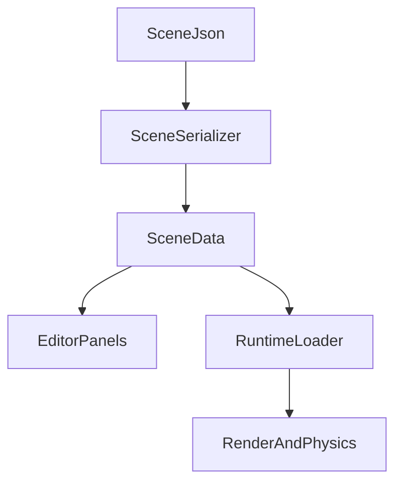

# Unity‑Like Editor Plan

## Clarify the concept (answering your question)

- A game editor is effectively a **scene file editor**: it creates/edits serialized entity/component data and writes a scene file. At runtime, the engine loads that file and instantiates entities/components.
- The **scene file should contain**: entities, hierarchy (parent/child), components + their properties, and references to assets by ID/path. It should **not** embed large asset data (meshes/textures). It can store script fields and references to other entities/components.
- In the future, your AI supervisor/graph can **author or modify the same JSON** scene file that the editor uses.

## Scope (first milestone: scene_basic, JSON, ImGui)

- Panels: **Hierarchy**, **Inspector**, **Scene View**, **Game View** (dockable via ImGui docking).
- Components in v1: `Transform`, `MeshRenderer` (mesh + material refs), `Collider` (box/sphere/capsule), optionally `RigidBody`.
- Scene file: JSON stored in `assets/scenes/*.json` (or a new `data/scenes` folder).

## Key files / modules to add

- New editor app target, e.g. `app/editor/` (ImGui + docking + viewport panels).
- Editor runtime layer: `eyelib/editor/` or `app/editor/*` for UI panels and scene editing logic.
- Scene serialization: new files under `eyelib/scene/` or `eyelib/serialize/` (JSON read/write).

## Data model (minimal)

- `Scene`
  - `entities[]`: each has `id`, `name`, `parent`, `components[]`
- `Transform`
  - position, rotation, scale
- `MeshRenderer`
  - mesh asset id/path, material id/path
- `Collider`
  - type + params

## Implementation steps

1. **Scene JSON schema**
  - Define minimal JSON structure for entities, hierarchy, and components.
  - Choose a stable entity ID format (uint or string UUID).
2. **Serializer/Deserializer**
  - Add load/save functions (likely in `eyelib/serialize/` and `eyelib/scene/`).
  - Resolve asset references to runtime objects.
3. **Editor app skeleton**
  - Create `app/editor` target using ImGui docking (same OpenGL backend).
  - Add panels: Hierarchy, Inspector, Scene view, Game view.
4. **Hierarchy panel**
  - List entities as a tree (parent/child).
  - Select entity; allow rename/reparent.
5. **Inspector panel**
  - Show/edit Transform and components.
  - Add “Add Component” menu for collider/rigidbody/mesh.
6. **Scene view interaction (basic)**
  - Camera controls and entity selection (raycast or simple picking).
7. **Runtime loading**
  - Load JSON scene and instantiate in the engine; confirm it renders and colliders exist.

## Minimal file touchpoints (expected)

- New: `app/editor/*` (editor app, docking UI, panels)
- New: `eyelib/scene/Scene.h/.cpp` (data model) or reuse existing scene types if suitable
- New/Update: `eyelib/serialize/SceneSerializer.*` (JSON load/save)
- Existing: `eyelib/render/*` and `eyelib/physics/*` for component instantiation

## Notes for later phases

- Script components (C++ or Lua) with editable fields.
- Asset Browser panel and drag‑drop assignment.
- Prefabs and scene composition.
- Graph/AI supervisor that edits the same JSON scene structure.

