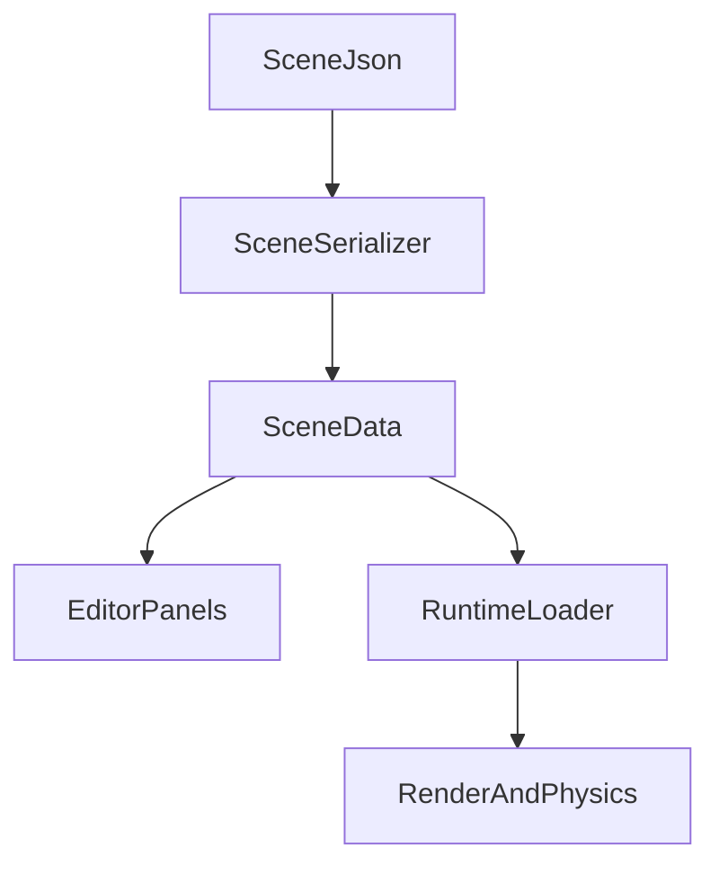

# Editor GUI Plan (Unity-like)

This document captures the current editor GUI plan discussed for OpenEye. The goal is to add a dockable editor UI layer (ImGui) that edits scenes data-driven, while keeping `eyelib` as a GUI-less runtime library.

## Goals

- Unity-like editor experience: Hierarchy, Inspector, Scene View, Game View, Asset Browser.
- Data-driven scenes so tools, AI supervisor, and future graph nodes can edit the same data.
- Keep `eyelib` focused on runtime (render/physics/animation/etc.).
- Editor UI runs in a separate app target (not coupled to runtime builds).

## Key Concept: Scene Files

A game editor is effectively a **scene file editor**. The editor:

- Edits a structured scene representation (entities + components + hierarchy).
- Saves to a scene file (JSON initially).
- The runtime loads the same file and instantiates objects.

The scene file should include:

- Entity list with stable IDs.
- Parent/child hierarchy.
- Components and their serialized properties.
- References to assets by ID or path.

It should not embed large asset data (meshes, textures). Those are referenced.

## Initial Scope (Milestone 1)

Selected scope: **scene_basic**, **JSON**, **ImGui**.

Panels:

- Hierarchy (tree of entities).
- Inspector (components and properties).
- Scene View (editor camera + selection).
- Game View (runtime camera preview).

Components in v1:

- Transform (position, rotation, scale).
- MeshRenderer (mesh + material).
- Collider (box, sphere, capsule).
- Optional: RigidBody.

## Editor Architecture

High-level flow:

1. Editor loads JSON scene.
2. Scene data is presented in UI (Hierarchy + Inspector).
3. User edits properties and hierarchy.
4. Editor saves JSON scene.
5. Runtime loads JSON and instantiates entities/components.

## Scene Data Model (Initial)

**Scene**
- entities: array

**Entity**
- id: number or string UUID
- name: string
- parent: id or null
- components: array

**Transform**
- position: vec3
- rotation: vec3 or quat
- scale: vec3

**MeshRenderer**
- mesh: asset reference (path or ID)
- material: asset reference (path or ID)

**Collider**
- type: box | sphere | capsule
- params: size/radius/height

**RigidBody** (optional)
- mass
- friction
- restitution

## UI Behavior (Editor)

Hierarchy:

- Tree view with parent/child.
- Select entity.
- Rename, reparent (drag/drop).
- Create/delete entities.

Inspector:

- Shows components of selected entity.
- Editable fields with validation.
- "Add Component" search and attach.

Scene View:

- Editor camera controls.
- Selection and gizmo support (translate/rotate/scale).

Game View:

- Renders runtime camera output.
- Toggle play/stop.

Asset Browser:

- Browse assets folder.
- Drag/drop into Inspector fields (mesh/material).

## Data-driven and AI Supervisor Compatibility

Because the scene is serialized to JSON, an AI supervisor or node graph can:

- Create entities.
- Modify component fields.
- Adjust hierarchy.
- Swap assets.

This matches the same data pipeline the editor uses.

## Project Structure (Proposed)

- `app/editor/*` (new editor app target)
- `eyelib/scene/*` (scene data model if not already present)
- `eyelib/serialize/SceneSerializer.*` (JSON load/save)
- `eyelib/editor/*` (optional editor UI helpers, not in runtime builds)

## Milestones

1. **Scene JSON + serializer**
   - Define schema
   - Load/save JSON
2. **Editor app skeleton**
   - ImGui docking
   - Panels: Hierarchy, Inspector, Scene, Game
3. **Basic editing**
   - Add/remove entities
   - Add components
   - Edit transforms and basic props
4. **Runtime loading**
   - Load JSON into runtime scene
   - Confirm render + physics

## Risks and Notes

- Entity ID stability: use UUIDs or incrementing IDs stored in file.
- Asset references: decide on path vs. asset ID registry.
- Script components: defer to milestone 2.
- Performance: editor is light; optimize later if needed.

## Next Steps

1. Confirm JSON schema details (ID type, asset references).
2. Create minimal serializer.
3. Create editor app target and basic panels.
4. Wire scene load/save into runtime.
