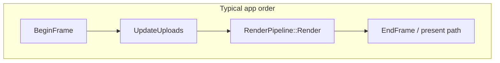
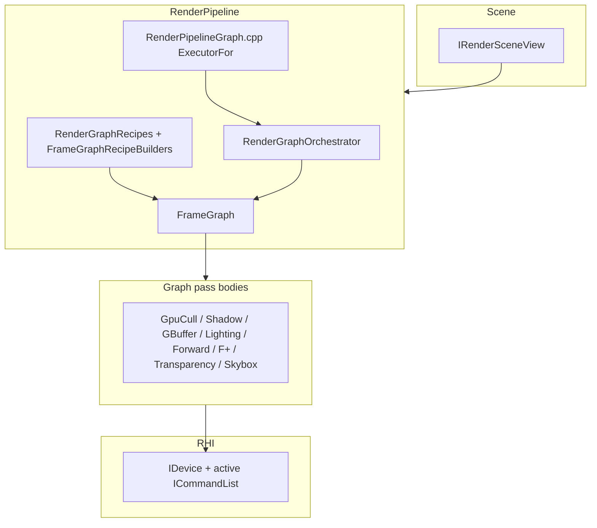

# OpenEye render module — full blueprint

This document is the **architecture and behavior blueprint** for `EngineSource/eyelib/render`: how data and GPU work flow through the module, how the three pipeline modes differ, and what each major file is for. It is meant to stay **aligned with code** (especially `RenderPipeline.cpp`, `RenderPipelineGraph.cpp`, and `RenderGraphRecipes.cpp`).

**Companion:** `EngineSource/eyelib/render/RENDER_MODULE.md` — deep RHI rules (editor Vulkan slices, `GetActiveRecordingCommandList`, submission). If this blueprint and `RENDER_MODULE.md` disagree on behavior, **trust the code**, then update the docs.

**File inventory scope:** Per-file tables cover the tree **excluding** `rhi/OpenGL/` and `rhi/diligent/` (those backends are large and mechanically similar). **`rhi/Vulkan/`** is summarized by subsystem in §5.19 (not one row per file) to keep this document maintainable.

---

## 1. Subsystems at a glance

| Subsystem | Role |
|-----------|------|
| **RHI** (`rhi/`) | `IDevice`, `ICommandList`, buffers, textures, pipelines, render targets, descriptors, barriers, optional bindless and GPU queries. Backends: OpenGL, Vulkan (optional), Diligent (optional). |
| **Scene contract** | `RenderTypes.h` + `IRenderSceneView.h` — camera, main light, skybox, opaque/transparent drawables, point/spot lights. Pipeline consumes a **view** to avoid copying vectors. |
| **Frame graph** (`framegraph/`) | Declares passes and resource read/write sets; compiles lifetimes, aliasing, and barriers; `Execute` runs callbacks in order. |
| **Orchestration** (`renderer/`) | `RenderPipeline` owns HDR/GBuffer/shadow/post/entity-ID resources, pass systems, caches, and `RenderGraphOrchestrator`. Builds `RenderFrameData`, chooses mode, runs graph then **post-graph** steps on the same command buffer. |
| **Pass systems** (`passes/`) | GPU cull, shadow, GBuffer, lighting, forward opaque/transparent, Forward+, transparency, skybox, editor overlay, streaming hooks. |
| **Resources** (`resources/`) | GPU `Mesh`, `Shader`, textures; CPU `MeshDescriptor`, loaders. |
| **Materials** (`materials/`) | Runtime `Material` / `MaterialInstance`, builders, compiler, shader bridge. |
| **Lighting / shadows / IBL / reflection** | Scene light buffers, cascaded shadows, IBL, reflection probes. |
| **Post** (`post/`) | `PostProcessor` — tone map, bloom, FXAA, optional effects; **invoked after the frame graph** from `RenderPipeline::Render` (see §3). |
| **2D / debug / submission** | Sprites, text, `DebugDrawRenderer`, `DrawBatch` / `BatchBuilder`. |

**Design threads**

- **Explicit `rhi::IDevice*`** on resource creation and loads; no global render device.
- **`RenderContext` / `GetActiveRecordingCommandList()`** — any per-frame GPU recording that must land in the correct submit batch must use the **active** list (editor offscreen slices). See `RENDER_MODULE.md` §3.4.
- **`UpdateUploads()`** — intended upload phase after `BeginFrame`, before `Render()`; currently a **no-op stub** in `RenderPipeline.cpp` (uploads still happen from other paths until refactored).

---

## 2. Single source of truth: `RenderPipeline::Render`

All three pipeline modes execute a **frame graph** for **scene** work (geometry, lighting composition into HDR, transparency, skybox where applicable). **Final post-processing is not in the frame graph recipe** — it runs once afterward on the same recording command buffer.

**Order inside `Render(const IRenderSceneView&, …)`** (see `RenderPipeline.cpp`):

1. `EnsureResources` / `Resize` as needed.
2. `cmd->Begin()` if not already recording.
3. **Frame graph** (one of):
   - **Hybrid** → `BuildAndExecuteFrameGraph`
   - **Forward** → `BuildAndExecuteForwardFrameGraph`
   - **ForwardPlus** → if `m_clusteredLightGrid` → `BuildAndExecuteForwardPlusFrameGraph`; **else** → `BuildAndExecuteForwardFrameGraph` (Forward+ **falls back** to the Forward graph when clustered lighting is unavailable).
4. **Entity ID pass** (optional) — R32UI picking when editor passes entity id vectors.
5. **`m_prePostCallback`** — optional hook into HDR before post (when `GetSceneForCallback()` is non-null).
6. **Debug draw** (when debug preset enabled) — into HDR.
7. **Pending debug lines** (colored) — via `EditorOverlayPassSystem`.
8. **`ExecutePostProcessPass`** — tone map / bloom / FXAA / etc. via `PostProcessPassSystem` + `PostProcessor` (**after** graph; see `RenderGraphRecipes.cpp` comment at top of file).
9. Clear RT binding; barrier output texture for read; leave `cmd` **open** for app blit — `EndFrame` completes submission.

**Comment in code:** `// Single path: all modes go through frame graph (Hybrid/Forward/ForwardPlus use BuildAndExecute*FrameGraph).`

---

## 3. Frame graph recipes (exact pass order)

Defined in `renderer/graph/RenderGraphRecipes.cpp`. Pass **string names** must match `renderer/graph/FrameGraphPassNames.h` and the dispatch table in `RenderPipeline::ExecutorFor` (`RenderPipelineGraph.cpp`).

**Important:** Recipes include **scene passes only**. They **do not** include tone mapping / bloom / FXAA — those run in `RenderPipeline::Render` after the graph (`RenderGraphRecipes.cpp` lines 9–10).

### 3.1 Hybrid (deferred opaque + forward transparency + skybox)

| Order | Pass name constant | What runs (high level) |
|------:|--------------------|-------------------------|
| 1 | `kGpuCull` | GPU cull / draw list prep (`GraphExecuteGpuCull`) |
| 2 | `kShadow` | Directional cascades → shadow map |
| 3 | `kGBuffer` | Opaque geometry → GBuffer MRT + depth |
| 4 | `kCopyDepthOcclusion` | Copy GBuffer depth for occlusion / motion use |
| 5 | `kLighting` | Fullscreen deferred lighting → **HDR** |
| 6 | `kTransparency` | `PrepareHybridTransparencyLighting` then transparency into HDR |
| 7 | `kSkybox` | Skybox with **GBuffer depth** (`GraphExecuteSkybox(true)`) |

### 3.2 Forward

| Order | Pass name constant | Notes |
|------:|--------------------|--------|
| 0 | `kGpuCull` | **Optional** — `BuildForwardRenderGraphRecipe(includeGpuCull)`; pipeline sets flag from frame prep |
| 1 | `kShadow` | Cascades |
| 2 | `kForwardOpaque` | Clear HDR, forward opaque |
| 3 | `kCopyDepthOcclusion` | Blit HDR depth → `m_prevFrameDepthRT` for temporal/occlusion |
| 4 | `kTransparency` | Sorted transparency |
| 5 | `kSkybox` | Skybox with **HDR** depth (`GraphExecuteSkybox(false)`) |

### 3.3 Forward+

| Order | Pass name constant | Notes |
|------:|--------------------|--------|
| 1 | `kShadow` | **No** GPU cull pass in this recipe |
| 2 | `kForwardPlusOpaque` | Inside executor: `PrepareForwardPlusFrame` (light grid / SSBOs) then `RenderForwardPlusOpaqueBatched` |
| 3 | `kTransparency` | Forward transparency (same graph hook as other modes) |
| 4 | `kSkybox` | HDR depth |

Forward+ **does** use the frame graph when `m_clusteredLightGrid` is non-null. It is **not** “graph-free”; that description is outdated relative to current `RenderPipeline.cpp`.

### 3.4 Forward stereo (separate graph wiring)

Base recipe (`BuildForwardStereoRenderGraphRecipe`): Shadow → Forward opaque → Transparency. **Skybox** is **not** in the vector recipe; `WireForwardStereoFrameGraph` appends **`SkyboxLeft`** and **`SkyboxRight`** passes (`FrameGraphRecipeBuilders.cpp`).

---

## 4. Pipeline modes (summary table)

| Mode | Frame graph recipe | Lighting model | Notable |
|------|----------------------|------------------|---------|
| **Hybrid** | `BuildDeferredRenderGraphRecipe` | Deferred fullscreen pass writes HDR; transparency forward | Transparency pass calls `PrepareHybridTransparencyLighting` (reuses Forward+ light prep with a flag). |
| **Forward** | `BuildForwardRenderGraphRecipe` | Forward shaders on HDR | Optional GPU cull first row. |
| **ForwardPlus** | `BuildForwardPlusRenderGraphRecipe` when clustered grid exists; else Forward recipe | Clustered / tiled light indices in forward+ shaders | **Same graph machinery** as other modes; opaque pass batches Forward+ draws. |

**`PipelineMode`** — `renderer/RenderPipelineMode.h`: `Hybrid`, `Forward`, `ForwardPlus`.

---

## 5. End-to-end diagrams

### 5.1 Application frame vs render module

### 5.2 Inside `RenderPipeline::Render` after frame graph

### 5.3 Ownership / wiring

**`PostProcessor` / `PostProcessPassSystem`** are invoked from **`RenderPipeline`** **after** `FG` completes — not as nodes inside `Build*RenderGraphRecipe()`.

---

## 6. Executor wiring and `FrameGraphExecutorSet`

- **`FrameGraphExecutorSet`** (`renderer/graph/FrameGraphExecutorSet.h`) is an **enum**: `Deferred`, `Forward`, `ForwardPlus`, `ForwardStereo`. It selects which **`RenderPipeline::ExecutorFor(set, name)`** branch runs for a given pass name (e.g. GPU cull is no-op for `ForwardPlus`; copy-depth executor differs for deferred vs forward).
- **`RenderPipelineGraph.cpp`** maps each `FrameGraphPassNames::*` string to a lambda that calls `GraphExecute*` methods on `RenderPipeline`.
- **`m_frameGraphExecutionContext`** holds the active `FrameRenderContext` during `FrameGraph::Execute` so graph bodies can read `frameData`, `cmd`, dimensions.

---

## 7. Major types and files (quick reference)

- **`FrameRenderContext`** (`renderer/FrameRenderContext.h`) — `device`, **active** `cmd`, `frameData`, dimensions, `frameIndex`.
- **`RenderContext`** (`RenderContext.h`) — lightweight `{ device, cmd }` for helpers (`Mesh`, `Shader`, post, debug).
- **`PassPushConstants.h`** — C++ push constant writers aligned with GLSL; single place to avoid VS/FS drift on Vulkan.
- **`GBuffer`** (`renderer/GBuffer.*`) — MRT + depth; bind/clear helpers for deferred geometry.
- **`CascadeShadowMap` + `ShadowPass`** (`shadows/`) — cascade splits and shadow rendering.
- **`ShaderCache` / `PipelineCache`** — loaded shaders and compiled pipelines.

---

## 8. Directory-centric file inventory (excluding `rhi/OpenGL`, `rhi/diligent`)

Each row: **path** — **role** (one line). Roles are descriptive, not a full API spec.

### 8.1 `eyelib/render/` (module root)

| File | Role |
|------|------|
| `IRenderSceneView.h` | Read-only scene interface; `RenderSceneView` wraps `const RenderScene&`. |
| `RenderTypes.h` | `Drawable`, `CameraView`, lights, `RenderScene`. |
| `RenderContext.h` | `{ device, cmd }`; prefer `FromDevice` so `cmd` is the **active** recording list. |
| `CameraConventions.h` | View/projection conventions shared with shaders. |
| `PassPushConstants.h` | Push constant layouts and writers (GBuffer, lighting, forward, etc.). |
| `PipelineSharedResources.h` | Shared shader/cache state when multiple pipelines share a device. |
| `RenderBackend.h` | Backend-facing helpers / enums at the render layer. |
| `RenderTarget.h` / `.cpp` | Engine render-target helpers around RHI. |
| `MeshDescriptor.h` | CPU mesh description → `Mesh::CreateFromDescriptor`. |
| `MeshDescriptorUtils.h` / `.cpp` | Mesh descriptor helpers. |
| `TextureDescriptor.h` | CPU texture creation metadata. |
| `Renderer.h` / `.cpp` | Minimal legacy clear+draw bring-up; **not** the main pipeline. |
| `FullscreenQuad.h` / `.cpp` | Fullscreen triangle/quad for passes and blits. |
| `GpuProfilerRHI.h` / `.cpp` | GPU timestamps / queries via RHI. |
| `DebugDrawRenderer.h` / `.cpp` | Debug draws into HDR with depth. |
| `InstancedRenderer.h` / `.cpp` | Instanced submission path. |
| `BatchRenderer.h` / `.cpp` | Draw batching / state coalescing. |
| `CullingSystem.h` / `.cpp` | CPU culling support / frustum tests. |
| `LODManager.h` / `.cpp` | LOD selection. |
| `StreamingHooks.h` / `.cpp` | Streaming integration hooks. |
| `ShaderKey.h` | Shader variant cache key. |
| `ShaderDescriptor.h` | Load-time shader metadata. |
| `ShaderPathResolve.h` | Logical name → filesystem path. |
| `ShaderTemplateName.h` | Shader template identifiers. |
| `ShaderLoader.h` / `.cpp` | Shader load orchestration. |
| `ShaderSourceLoader.h` / `.cpp` | Source read / preprocess. |
| `ShaderReflection.h` / `.cpp` | Uniform/binding reflection for binding glue. |
| `ShaderCache.h` / `.cpp` | Loaded `Shader` instances. |
| `ShaderWatcher.h` / `.cpp` | Hot reload file watch. |
| `PipelineCache.h` / `.cpp` | Compiled `IPipeline` cache. |
| `RENDER_MODULE.md` | In-tree RHI + frame rules; **verify ForwardPlus / frame graph bullets** against this blueprint. |

### 8.2 `framegraph/`

| File | Role |
|------|------|
| `FrameGraph.h` / `.cpp` | Graph API: resources, passes, compile, execute, barriers. |
| `FrameGraphRecipe.h` / `.cpp` | `AddPassesFromRecipe` — string pass names → registered executors. |

### 8.3 `renderer/`

| File | Role |
|------|------|
| `RenderPipeline.h` / `.cpp` | Main pipeline: init, resize, `Render`, stereo, entity ID, post, blit, caches. |
| `RenderPipelineGraph.cpp` | `ExecutorFor`, `GraphExecute*`, graph build helpers. |
| `RenderPipelineMode.h` | `PipelineMode` enum. |
| `GBuffer.h` / `.cpp` | Deferred GBuffer targets and helpers. |
| `FrameRenderContext.h` | Per-frame inputs for pass systems during graph execution. |

### 8.4 `renderer/graph/`

| File | Role |
|------|------|
| `RenderGraphOrchestrator.h` / `.cpp` | Owns `FrameGraph`; `CompileIfNeeded` on resize/mode/stereo/dirty. |
| `RenderGraphRecipes.h` / `.cpp` | Ordered pass name lists per mode (source of pass **order**). |
| `FrameGraphRecipeBuilders.h` / `.cpp` | Imports RHI textures into graph handles; wires recipes. |
| `FrameGraphPassNames.h` | String literals for pass names — must match recipes + `ExecutorFor`. |
| `FrameGraphExecutorSet.h` | **Enum** selecting deferred vs forward vs forward+ vs stereo executor tables. |

### 8.5 `passes/`

| File | Role |
|------|------|
| `GpuCullPassSystem.h` / `.cpp` | GPU-driven cull list / indirect draw integration. |
| `ShadowPassSystem.h` / `.cpp` | Shadow pass orchestration for the graph. |
| `ShadowPassParams.h` | Shadow pass parameters. |
| `GBufferPassSystem.h` / `.cpp` | GBuffer geometry pass (static, instanced, skinned). |
| `GBufferPassOpaqueParams.h` | Opaque GBuffer tunables. |
| `DeferredLightingPassSystem.h` / `.cpp` | Deferred lighting fullscreen pass. |
| `LightingPass.h` / `.cpp` | Lighting shaders and draw helpers. |
| `ForwardOpaquePassSystem.h` / `.cpp` | Forward opaque orchestration. |
| `ForwardOpaqueGeometry.cpp` | Forward opaque geometry recording. |
| `ForwardOpaqueStereoGeometry.cpp` | Stereo forward opaque. |
| `ForwardTransparentGeometry.cpp` | Forward transparent draws. |
| `ForwardPlusOpaqueGeometry.cpp` | Forward+ opaque draws (tiled/cluster data). |
| `ForwardPlusFramePrep.cpp` | Forward+ per-frame buffer/grid updates. |
| `ForwardGeometryCommon.h` | Shared forward geometry declarations. |
| `TransparencyPass.h` / `.cpp` | Transparency draw implementation details. |
| `TransparencyPassSystem.h` / `.cpp` | Transparency pass system invoked from graph. |
| `SkyboxPassSystem.h` / `.cpp` | Skybox rendering. |
| `PostProcessPassSystem.h` / `.cpp` | Builds/executes **`PostProcessor`** for **`ExecutePostProcessPass`** (post-graph path; **not** a `FrameGraph` recipe node). |
| `LightCullPassSystem.h` / `.cpp` | GPU light culling for clustered/tiled paths. |
| `EditorOverlayPassSystem.h` / `.cpp` | Editor overlays and debug-line overlay execution. |
| `StreamingPassSystem.h` / `.cpp` | Streaming-related pass bucket when used. |

### 8.6 `passes/detail/`

| File | Role |
|------|------|
| `GpuCullPass.h` / `.cpp` | GPU cull compute/dispatch implementation. |
| `LightCullPass.h` / `.cpp` | Light cull compute/dispatch implementation. |

### 8.7 `passes/common/`

| File | Role |
|------|------|
| `ForwardSharedStateWriter.h` / `.cpp` | Shared forward state (UBOs/push) for lights/camera. |
| `ForwardSharedEnvironment.h` | Shared forward environment parameters. |

### 8.8 `shadows/`

| File | Role |
|------|------|
| `CascadeShadowMap.h` / `.cpp` | Cascade matrices, atlas, sampling setup. |
| `ShadowPass.h` / `.cpp` | Renders depth from light view into cascades. |

### 8.9 `lighting/`

| File | Role |
|------|------|
| `SceneLighting.h` / `.cpp` | Fills GPU scene lighting buffers from ECS/scene. |
| `ClusteredLightGrid.h` / `.cpp` | Clustered grid for Forward+ / hybrid transparency prep. |
| `TiledLightGrid.cpp` | Tiled light grid implementation (no separate `.h` in tree). |

### 8.10 `ibl/`

| File | Role |
|------|------|
| `IBL.h` / `.cpp` | IBL textures and bind/generation paths. |

### 8.11 `reflection/`

| File | Role |
|------|------|
| `ReflectionProbe.h` | Single probe representation. |
| `ReflectionProbeManager.h` / `.cpp` | Probe manager and integration with draws. |
| `ReflectionProbe.cpp` | Probe-related implementation. |

### 8.12 `post/`

| File | Role |
|------|------|
| `PostProcessor.h` / `.cpp` | HDR post chain; Vulkan multi-descriptor-set layout. |

### 8.13 `materials/`

| File | Role |
|------|------|
| `Material.h` / `.cpp` | Runtime material. |
| `MaterialInstance.h` / `.cpp` | Instance overrides. |
| `MaterialDescriptor.h` | Serializable material description. |
| `MaterialBuilder.h` / `.cpp` | Fluent material construction. |
| `MaterialCompiler.h` / `.cpp` | Descriptor → runtime material. |
| `MaterialShader.h` / `.cpp` | Material → shader permutation bridge. |

### 8.14 `resources/`

| File | Role |
|------|------|
| `Mesh.h` / `.cpp` | GPU mesh. |
| `MeshOptimizer.h` / `.cpp` | CPU mesh optimization. |
| `Shader.h` / `.cpp` | High-level shader binds. |
| `Texture2D.h` / `.cpp` | 2D texture. |
| `Texture3D.h` / `.cpp` | 3D texture. |
| `TextureCube.h` / `.cpp` | Cubemap. |
| `TextureArray.h` / `.cpp` | 2D array texture. |
| `TextureTypes.h` | Shared texture typedefs/enums. |
| `TextureLoader.h` / `.cpp` | File loading (HDR/LDR). |
| `PassResourceBuilders.h` / `.cpp` | Per-pass resource builder helpers. |

### 8.15 `2d/`

| File | Role |
|------|------|
| `Sprite.h` / `.cpp` | Sprite data. |
| `SpriteRenderer.h` / `.cpp` | Batched sprites. |
| `Font.h` / `.cpp` | Font atlas. |
| `TextRenderer.h` / `.cpp` | Text rendering. |
| `Primitives.h` / `.cpp` | 2D primitives. |

### 8.16 `submission/`

| File | Role |
|------|------|
| `DrawBatch.h` | Instancing batch struct (`Mesh` + `Material` + transforms). |
| `BatchBuilder.cpp` | Builds batches from drawables. |

### 8.17 `backend/`

| File | Role |
|------|------|
| `RenderBackendPolicy.h` / `.cpp` | Backend capability policy (e.g. which transparency path). |

### 8.18 `rhi/` — shared (non-OpenGL, non-Diligent)

| File | Role |
|------|------|
| `RHI.h` | Core RHI interfaces. |
| `RHITypes.h` | Resource and pipeline descriptors, enums. |
| `RHIUtils.h` / `.cpp` | Cross-backend helpers. |
| `RHIUniformLayout.h` | Uniform layout conventions. |
| `ResourceSetLayoutDesc.h` / `.cpp` | Descriptor set layout descriptions. |
| `PipelineAttachmentFormatSets.h` | Standard attachment format sets. |
| `CreateDevice.h` | Declarations for `CreateOpenGLDevice` / `CreateGraphicsDevice` / Vulkan and Diligent factories as enabled. |
| `CreateDevice.cpp` | Device factory implementations. |

### 8.19 `rhi/Vulkan/` — Vulkan backend (subsystem map)

| Area | Files (pattern) | Role |
|------|-----------------|------|
| Core | `core/DeviceVK.*`, `DeviceVKPresentation.cpp`, `CreateDeviceVulkan.*`, `InstanceVK.*`, `PhysicalDeviceVK.*`, `QueuesVK.*`, `SwapchainVK.*`, `FrameContextVK.*` | Device, swapchain, frames in flight, presentation. |
| Commands | `commands/CommandBufferVK.*`, `CommandListVK.*`, `CommandPoolVK.*` | Recording and pools. |
| Resources | `resources/BufferVK.*`, `TextureVK.*`, `RenderTargetVK.*` | GPU resources. |
| Memory | `memory/AllocatorVK.*`, `UploadHeapVK.*`, `DeletionQueueVK.*`, `vk_mem_alloc.h` | Allocation and lifetime. |
| Descriptors | `descriptors/*VK.*`, `BindlessHeapVK.*` | Descriptor heaps, sets, caching. |
| Pipelines | `pipelines/PipelineVK.*`, `PipelineLayoutVK.h`, `ShaderVK.*`, `VulkanGlslToSpirv.*`, `VulkanPipelineHash.*`, `VulkanResourceSpaces.*`, `VulkanBindingUtils.*` | SPIR-V pipelines and binding model. |
| Barriers / sync | `barriers/*`, `sync/*` | State tracking, fences, queries. |
| Utils | `utils/DebugUtilsVK.*`, `utils/VulkanEnums.h` | Debug names, enum mapping. |
| Doc | `descriptor_binding_table.md` | Binding table reference for shaders. |

---

## 9. Omitted backend trees (not listed file-by-file)

- **`rhi/OpenGL/`** — OpenGL `IDevice` implementation (immediate + deferred command lists, GL resources, descriptor emulation).
- **`rhi/diligent/`** — Optional Diligent backend.

Wiring: `rhi/CreateDevice.cpp` + `EyelibRender` `CMakeLists.txt`.

---

## 10. How to extend (checklist)

1. **New frame-graph pass:** Add `FrameGraphPassNames` literal → append to the right `Build*RenderGraphRecipe()` → handle in `Wire*FrameGraph` if new resource names → implement `GraphExecute*` + branch in `ExecutorFor` for each `FrameGraphExecutorSet` that should run it (or `NoOpExecutor`).
2. **New post effect:** Extend `PostProcessor` and the `ExecutePostProcessPass` / `PostProcessPassSystem` path — **do not** add tone map to `Build*RenderGraphRecipe` unless you intentionally duplicate work and reorder barriers.
3. **New RHI resource type:** Extend `IDevice` + each backend; extend `RHITypes.h` descriptions.

---

## 11. Related paths outside `eyelib/render`

- **Shaders:** `EngineSource/assets/shaders/{vulkan|opengl}/…`
- **Public API layer:** `EngineSource/api/render/` — thin wrappers, `ApiRenderSceneView`, `RenderDevice` handle (see `RENDER_MODULE.md` §2.2).

---

*Blueprint aligned with `RenderPipeline.cpp`, `RenderPipelineGraph.cpp`, and `RenderGraphRecipes.cpp`. Update when pass order, post-graph sequence, or mode fallback behavior changes.*
